# Panel Creality

Panel web no oficial para controlar y vigilar impresoras con Klipper desde el navegador, en el ordenador o en el móvil. Reúne todas tus impresoras en un hub: cada una con su estado, su CFS si lo tiene y sus cámaras, y avisos de todas en un mismo lugar. Reconoce las Creality K1 SE, K1 SE Combo, K1, K1C, K1 Max, K2 SE, K2 SE Combo, SparkX i7, SparkX i7 Combo y Ender-5 Max, la Snapmaker U1 con sus cuatro cabezales, y sirve para cualquier otra impresora con Klipper y Moonraker, ocultando lo que una impresora no tiene.

No necesita compilación: son archivos HTML, CSS y JavaScript. Para varias impresoras y cámaras se sirve desde un servidor con nginx (un PC, un contenedor o una Raspberry Pi).

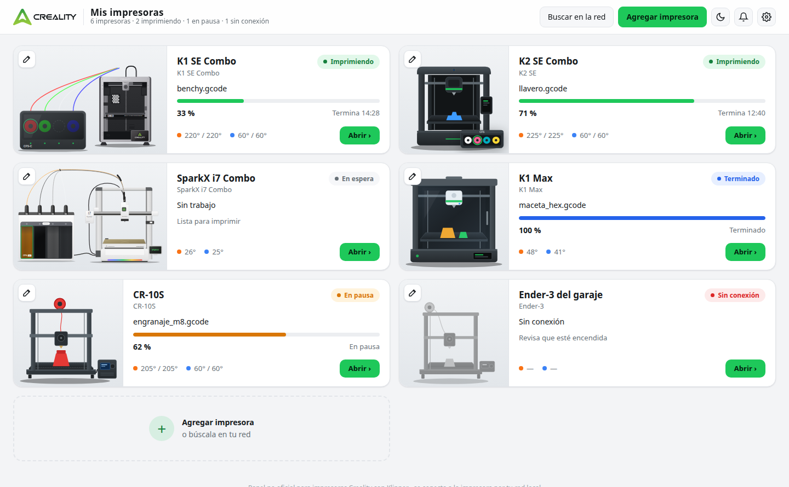

## Funciones

**Hub de impresoras**

- Una tarjeta por impresora con su ilustración (o una foto tuya) a la izquierda y, a la derecha, estado, archivo, progreso, hora de fin y temperaturas.
- Si la impresora tiene CFS, la tarjeta lo dibuja con los colores reales de cada ranura y marca la que está en uso.
- Búsqueda automática de impresoras en la red, o alta manual con nombre, modelo e IP.
- La lista de impresoras, sus cámaras y sus fotos se guardan en el servidor, así que todos tus dispositivos ven lo mismo.
- Avisos de todas las impresoras, no solo de la que tengas abierta.

**Diseño**

- Tema claro (por defecto) y oscuro, con un botón en la cabecera para cambiar entre ellos. La elección se recuerda en cada navegador.
- Adaptado al móvil: las tarjetas del hub se apilan en una columna, la cabecera se compacta y las pestañas, la cámara y los diálogos se ajustan a pantallas pequeñas.

**Panel de cada impresora**

- **Trabajo actual:** progreso, capa, tiempo transcurrido y restante, hora estimada de fin, filamento consumido frente al total, peso actual frente al peso final, y miniatura del modelo. Pausar, reanudar y cancelar.
- **Cámaras:** varias por impresora, con un selector para cambiar entre ellas. Admite la cámara de las K1 (WebRTC de Creality), cámaras IP con RTSP como las Tapo (a través de go2rtc) y cualquier cámara MJPEG (un móvil con IP Webcam, una ESP32-CAM o una webcam en una Raspberry Pi). Captura de imagen, pantalla completa y botón de luz.
- **Control:** temperaturas de boquilla y cama con preajustes para PLA, PETG y ABS, gráfica de los últimos 10 minutos, velocidad, flujo, ventilador, ajuste fino del offset Z, movimiento de ejes, home y extrusión manual.
- **Parada de emergencia (PANIC BUTTON):** hay que pulsarla dos veces en 3 segundos, para que un toque accidental no detenga una impresión. Si Klipper se cae, aparece un aviso con botones para reiniciar el firmware, Klipper o el servicio.
- **Cabezales (Snapmaker U1):** los cuatro cabezales con su temperatura, el material y el color de cada carrete (leídos por RFID), cuál está en uso y botón para cambiar de cabezal fuera de impresión. La tarjeta de temperatura del Control usa el cabezal activo.
- **CFS:** estado de las ranuras (material, color y restante con RFID), carga y descarga de filamento, edición de material y color, recorrido del filamento, temperatura y humedad, y sus opciones (recarga automática, cambio automático de ranura, precarga).
- **Nivelación:** mapa de color de la malla de la cama con el punto más bajo, el más alto y la diferencia total.
- **Archivos:** lista de G-code con miniatura, tiempo, peso y material, búsqueda y subida por arrastrar y soltar.
- **Timelapses:** reproducción y descarga de los vídeos que graban las K1.
- **Estadísticas:** horas de impresión, trabajos, tasa de éxito, filamento usado y coste estimado, horas por día de los últimos 30 días, consumo por material y colores más usados.
- **Mantenimiento:** tareas con aviso por horas de impresión, días o cortes del CFS, guardadas en cada impresora.
- **Consola e historial:** envío de G-code con historial de comandos, y últimos trabajos con botón para volver a imprimir.
- **Avisos:** al terminar, al fallar o cancelarse, al pausarse o agotarse el filamento, cuando faltan 10 minutos y cuando una temperatura llega a su objetivo. Llegan como aviso del navegador con sonido y, opcionalmente, al móvil por ntfy o Telegram.

## Capturas

### Primera vez

Sin impresoras, el panel muestra una portada para buscarlas en la red o agregarlas a mano.

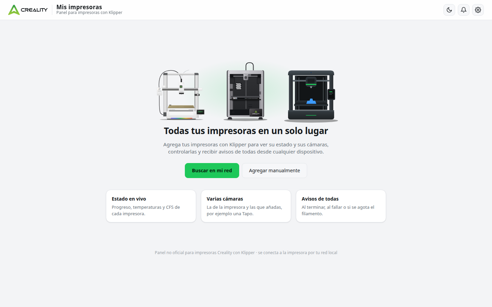

### Buscar y agregar impresoras

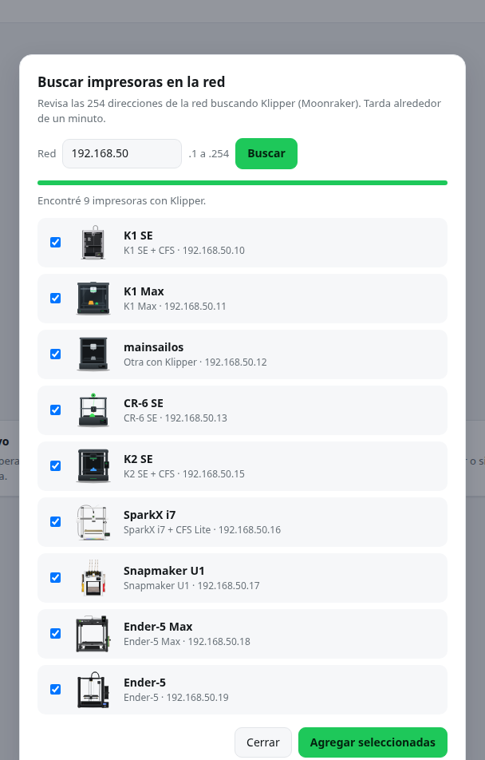 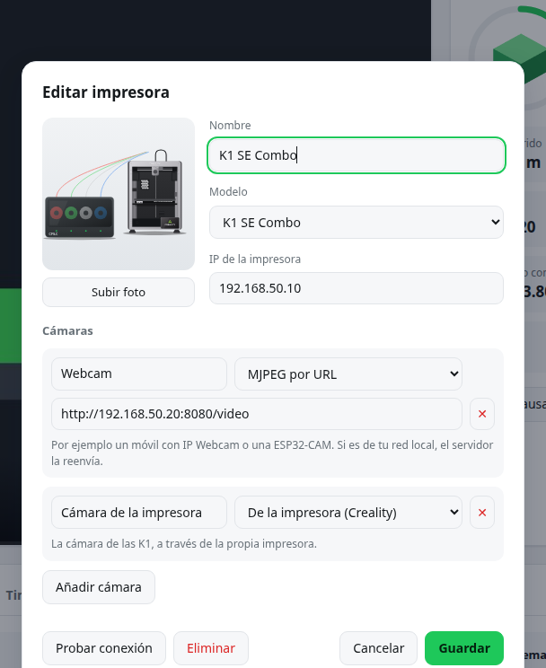

### Panel de una impresora

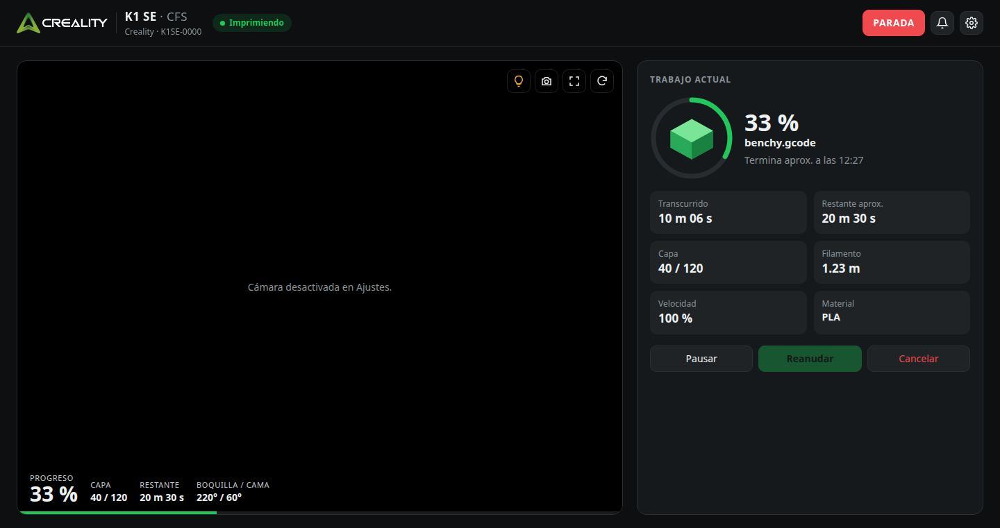

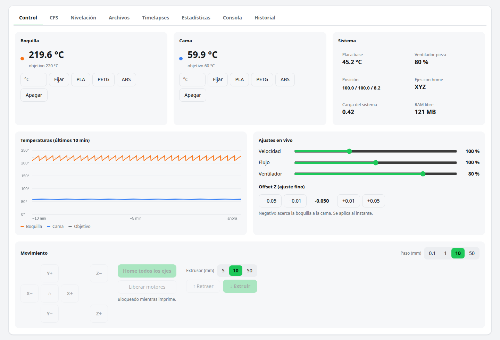

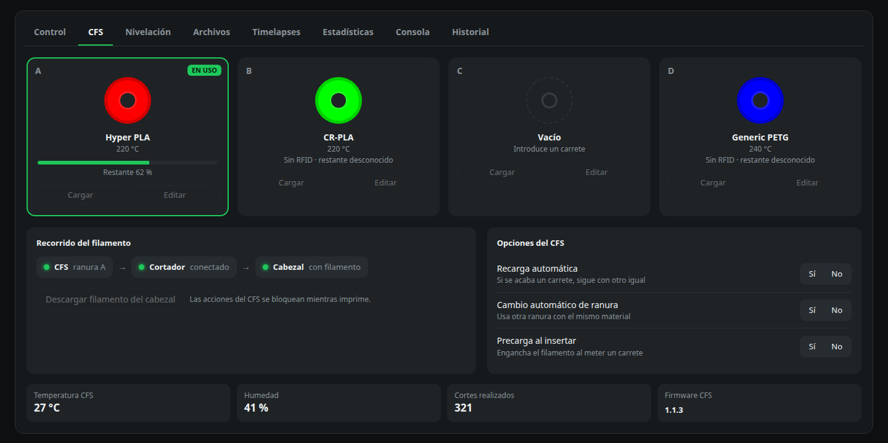

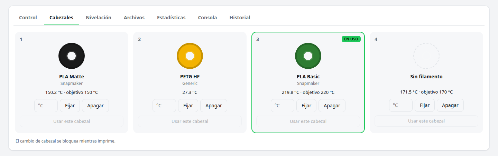

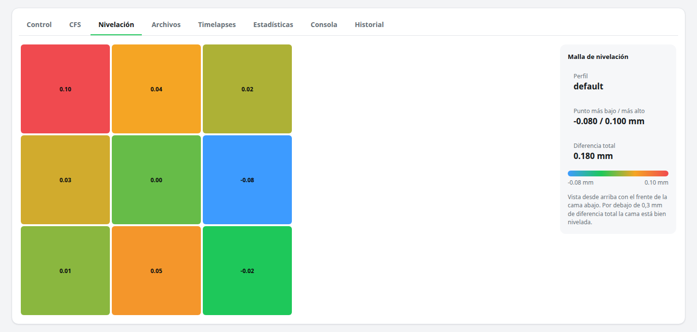

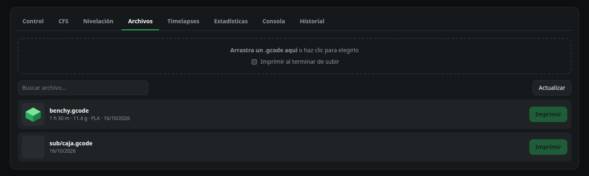

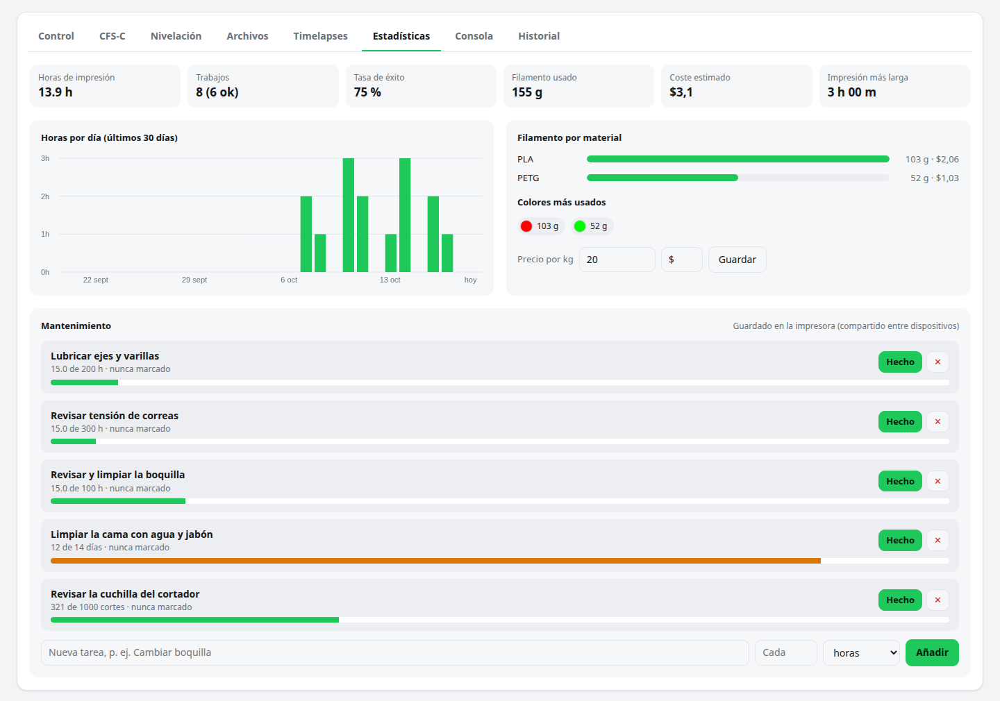

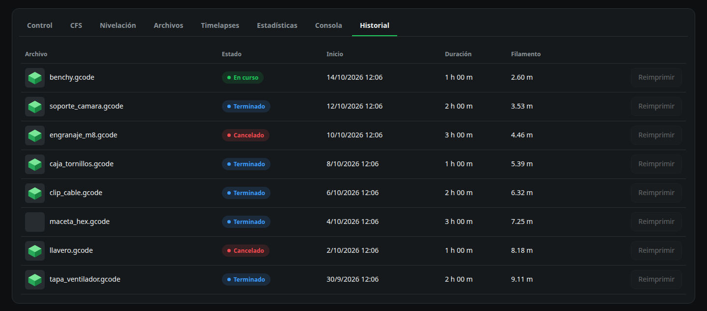

### Tema oscuro

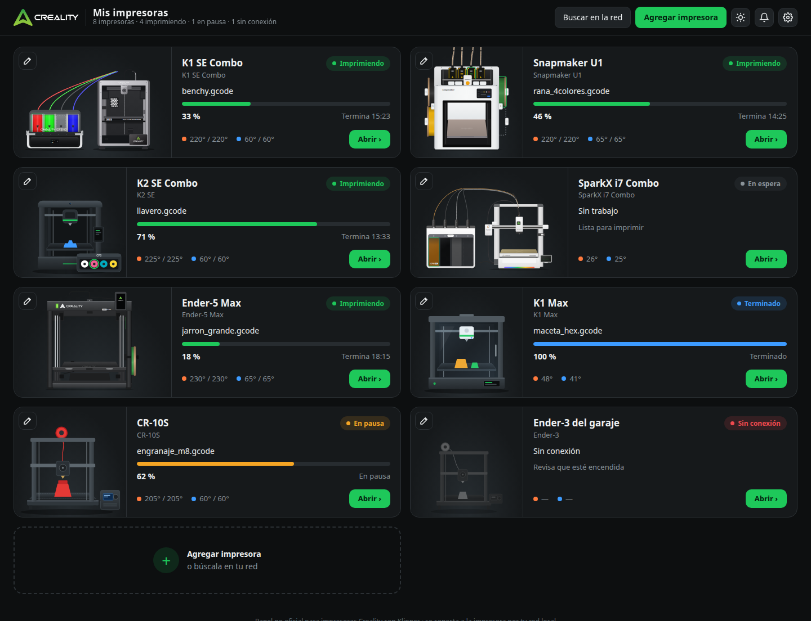

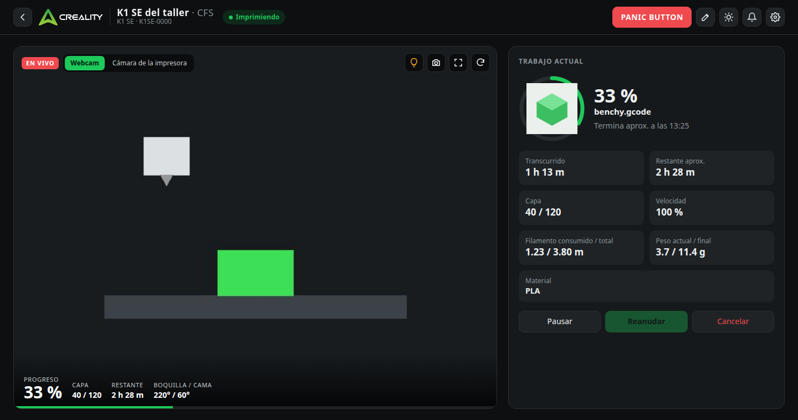

### Ajustes y móvil

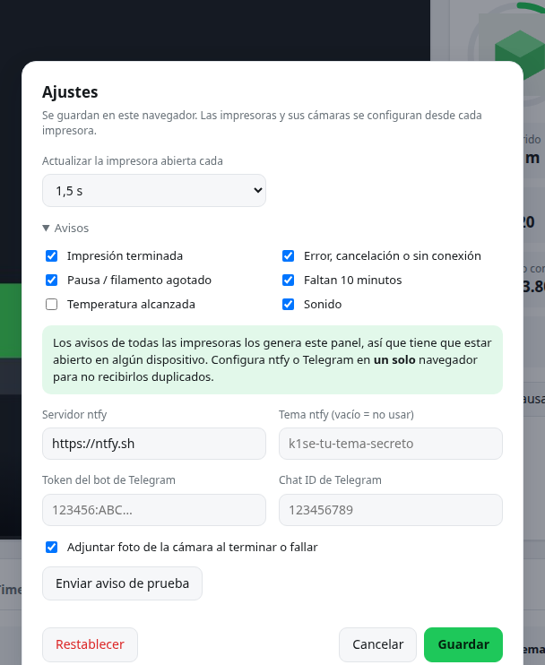

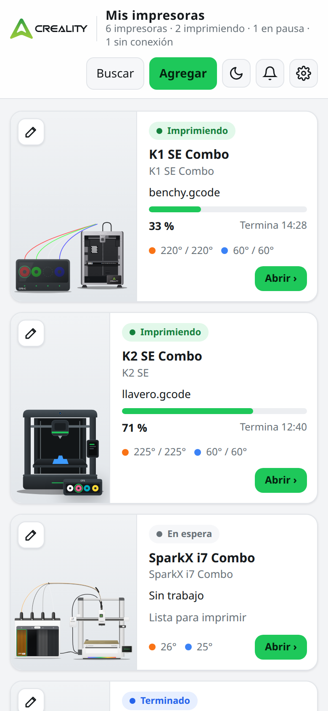 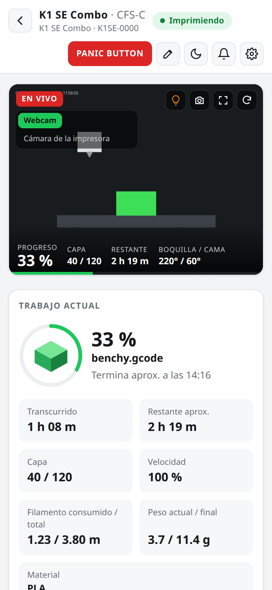

Las capturas están hechas con impresoras y cámaras simuladas. Las ilustraciones de las impresoras son propias del proyecto; cada impresora puede usar en su lugar una foto tuya.

## Modelos compatibles

| Modelo | Sistema de filamento | Cámara integrada | Timelapses |
| --- | --- | --- | --- |
| K1 SE | No (monocolor) | Sí | Sí |
| K1 SE Combo | CFS-C | Sí | Sí |
| K1, K1C y K1 Max | CFS | Sí | Sí |
| K2 SE y K2 SE Combo | CFS (en la Combo) | Sí | Sí |
| SparkX i7 | No (monocolor) | Sí | No |
| SparkX i7 Combo | CFS Lite | Sí | No |
| Ender-5 Max | CFS (opcional) | Con la cámara Nebula | Sí |
| Snapmaker U1 | 4 cabezales con RFID | Con el firmware Extended (ver abajo) | No |
| CR-10S, CR-6 SE, Ender-3 y otras con Klipper | No | Con una webcam o una Tapo | No |

El modelo se detecta solo por el nombre de la impresora en la red, la versión Combo según si tiene un CFS conectado y la Snapmaker U1 por sus cuatro cabezales; si no lo reconoce, se puede elegir al editarla. En el hub, las versiones Combo muestran la impresora junto a su CFS, con las bobinas y los tubos en los colores reales de cada ranura.

A tener en cuenta:

- **SparkX i7:** el firmware 1.1.2.4 (abril de 2026) desactivó el acceso root por defecto. El panel no necesita root, solo Moonraker en el puerto 7125, pero esta combinación no se ha podido comprobar con una impresora real. Su WebSocket de estado es distinto al de las K1, por eso no tiene pestaña de timelapses.
- **K2:** algunos firmwares recientes de la serie K2 dejaron de mostrar el vídeo en la página del puerto 8000. El panel no usa esa página sino la conexión WebRTC directa; si aun así la cámara no se ve, se puede pasar por go2rtc (ver "Cámara de la impresora a través de go2rtc").
- **Ender-5 Max:** usa el mismo sistema que las K1. Moonraker se activa con root (firmware 1.2.0.21 o posterior) y el Creality Helper Script, igual que en las K1. No trae cámara; la Nebula opcional se añade como "De la impresora (Creality)". Si tiene un CFS conectado, el panel lo detecta y muestra su pestaña.
- **Snapmaker U1:** usa Klipper y Moonraker modificados por Snapmaker, con Moonraker en el puerto 7125 y sin clave en la red local. El panel lee los cabezales `extruder` a `extruder3`, el cabezal activo y el filamento de `print_task_config`, y cambia de cabezal con `T0` a `T3`. En el hub, la ilustración pinta cada carrete con su color real; se asume que los carretes 1 y 2 (izquierda, de arriba abajo) y 3 y 4 (derecha) corresponden a los cabezales 1 a 4. La cámara integrada del firmware original usa un método propio de Snapmaker que el panel no implementa; con el [firmware Extended](https://snapmakeru1-extended-firmware.pages.dev/) la cámara se puede añadir como "MJPEG por URL" o como RTSP por go2rtc. Este soporte se ha hecho a partir del código publicado por Snapmaker y no se ha podido comprobar con una impresora real.
- **CR-10S, CR-6 SE y Ender-3:** de fábrica usan Marlin; necesitan Klipper y Moonraker en un ordenador como una Raspberry Pi.

## Requisitos

- Impresoras con Klipper y Moonraker accesibles en la red local. Las K1 los traen; otras impresoras, como una CR-10S o una CR-6 SE, necesitan Klipper instalado en un ordenador pequeño, como una Raspberry Pi.
- Para usar varias impresoras y cámaras: un servidor en la misma red con nginx. Sirve un PC con Linux, un contenedor o una Raspberry Pi.
- Un navegador actual (Chrome, Edge, Firefox o Safari).

Puertos de las impresoras que usa el panel:

| Servicio | Puerto | Para qué |
| --- | --- | --- |
| Moonraker | 7125 | Estado, control, archivos, historial y estadísticas |
| Cámara WebRTC de Creality | 8000 | Vídeo de las K1 |
| WebSocket de Creality | 9999 | Lista de timelapses de las K1 |
| Web de la impresora | 80 | Vídeos de timelapse y webcams de una Raspberry Pi |

## Instalación en un servidor

1. Copia `index.html`, `css/`, `js/` e `img/` a una carpeta del servidor, por ejemplo `/var/www/panel`. La carpeta `docs/` solo la usa este README.
2. Crea la carpeta donde el panel guardará la lista de impresoras y las fotos:

   ```bash
   sudo install -d -o www-data -g www-data -m 755 /var/lib/crpanel
   ```

3. Configura nginx con este sitio (cambia `root` por la carpeta del paso 1):

   ```nginx
   map $http_upgrade $panel_conn {
       default upgrade;
       ''      close;
   }

   server {
       listen 80;
       server_name _;
       root /var/www/panel;
       index index.html;

       location / {
           try_files $uri $uri/ /index.html;
           add_header Cache-Control "no-cache";
       }

       location /panel-data/ {
           alias /var/lib/crpanel/;
           dav_methods PUT DELETE;
           create_full_put_path on;
           dav_access user:rw group:r all:r;
           client_max_body_size 10m;
           add_header Cache-Control "no-store";
           limit_except GET PUT DELETE { deny all; }
       }

       location ~ "^/p/(?<p_ip>10(?:\.\d{1,3}){3}|192\.168(?:\.\d{1,3}){2}|172\.(?:1[6-9]|2\d|3[01])(?:\.\d{1,3}){2})/(?<p_port>80|81|7125|8000|8080|9999)(?:/|$)" {
           set $p_rest "";
           if ($request_uri ~ "^/p/[^/]+/\d+/?(?<p_tail>.*)$") {
               set $p_rest $p_tail;
           }
           proxy_pass http://$p_ip:$p_port/$p_rest;
           proxy_http_version 1.1;
           proxy_set_header Host $p_ip:$p_port;
           proxy_set_header Upgrade $http_upgrade;
           proxy_set_header Connection $panel_conn;
           proxy_connect_timeout 1s;
           proxy_read_timeout 3600s;
           proxy_send_timeout 3600s;
           proxy_buffering off;
           proxy_request_buffering off;
           client_max_body_size 1024m;
       }

       location = /go2rtc/api/ws {
           limit_except GET { deny all; }
           proxy_pass http://127.0.0.1:1984/api/ws;
           proxy_http_version 1.1;
           proxy_set_header Upgrade $http_upgrade;
           proxy_set_header Connection $panel_conn;
           proxy_read_timeout 3600s;
           proxy_buffering off;
       }
   }
   ```

4. Comprueba la configuración y recarga nginx con `sudo nginx -t && sudo systemctl reload nginx`.
5. Abre el panel en el navegador y usa "Buscar en mi red" o "Agregar manualmente".

Cómo funciona: el navegador nunca habla directamente con las impresoras. Todo pasa por el servidor con rutas del tipo `/p/<IP>/<puerto>/`, así que agregar una impresora desde el panel no exige tocar nginx, y el panel funciona igual desde fuera de casa a través de una VPN como Tailscale. La ruta solo acepta IPs de red local y los puertos de la tabla anterior (más el 81 y el 8080, habituales en cámaras MJPEG). La lista de impresoras la guarda nginx directamente como un archivo JSON, sin base de datos ni otros programas.

El panel no tiene usuario ni contraseña: cualquiera que pueda abrirlo puede controlar las impresoras. No lo publiques en internet; para usarlo fuera de casa, usa una VPN como Tailscale.

Todo esto funciona igual en una Raspberry Pi con Raspberry Pi OS: nginx está en sus repositorios y go2rtc tiene versiones para ARM.

### Abrirlo como archivo

También puedes abrir `index.html` con doble clic. En ese modo el navegador se conecta directamente a cada impresora, la lista de impresoras se guarda solo en ese navegador, no se pueden subir fotos y no funcionan las cámaras de go2rtc. Si venías de la versión de una sola impresora, tu impresora aparece automáticamente en el hub.

## Cámaras

Cada impresora puede tener varias cámaras; se añaden con el botón del lápiz, en su tarjeta o en su panel.

| Tipo | Para qué cámaras | Qué hace falta |
| --- | --- | --- |
| De la impresora (Creality) | La cámara integrada de las K1, K2 SE y SparkX i7, o la Nebula de la Ender-5 Max | Nada |
| Tapo o RTSP (go2rtc) | Cámaras IP como Tapo C100 o C110, Reolink o Imou | go2rtc en el servidor |
| MJPEG por URL | Un móvil con IP Webcam, una ESP32-CAM, una webcam en una Raspberry Pi con crowsnest | La URL del vídeo |

Las cámaras go2rtc y MJPEG pasan por el servidor, así que se ven igual desde fuera de casa. La cámara de las K1 usa WebRTC y su vídeo va directo de la impresora al navegador: fuera de casa solo se ve si Tailscale te da acceso a tu red local (con un subnet router).

### Conectar una cámara Tapo

1. En la app de Tapo, en los ajustes avanzados de la cámara, crea una "Cuenta de la cámara" con un usuario y una contraseña. Sin ella la cámara no ofrece RTSP.
2. Instala go2rtc en el servidor. Descarga el binario de tu arquitectura desde [sus versiones en GitHub](https://github.com/AlexxIT/go2rtc/releases) a `/usr/local/bin/go2rtc` y crea `/etc/go2rtc/go2rtc.yaml`:

   ```yaml
   api:
     listen: "127.0.0.1:1984"
     origin: "*"
   rtsp:
     listen: "127.0.0.1:8554"
   webrtc:
     listen: ""
   streams:
     tapo_k1: rtsp://USUARIO:CONTRASEÑA@IP_DE_LA_CAMARA:554/stream1
   ```

   `stream1` es la calidad máxima; `stream2` es una versión más ligera, útil para el móvil o redes lentas.
3. Créale un servicio para que arranque solo, por ejemplo `/etc/systemd/system/go2rtc.service`:

   ```ini
   [Unit]
   Description=go2rtc
   After=network-online.target

   [Service]
   User=go2rtc
   ExecStart=/usr/local/bin/go2rtc -config /etc/go2rtc/go2rtc.yaml
   Restart=always
   NoNewPrivileges=true
   ProtectSystem=strict
   ProtectHome=true

   [Install]
   WantedBy=multi-user.target
   ```

   y actívalo con `sudo useradd --system --no-create-home go2rtc && sudo systemctl enable --now go2rtc`.
4. En el panel, edita la impresora, añade una cámara de tipo "Tapo o RTSP (go2rtc)" y escribe el nombre del stream (`tapo_k1` en el ejemplo).

### Cámara de la impresora a través de go2rtc

La cámara integrada de las K1, K2 y SparkX también se puede pasar por go2rtc. Así se ve desde fuera de casa sin acceso a la red local, y sirve de alternativa si un firmware nuevo cambia la forma de mostrarla. Añade el stream en `go2rtc.yaml`:

```yaml
streams:
  k2se: webrtc:http://IP_DE_LA_IMPRESORA:8000/call/webrtc_local#format=creality
```

y en el panel usa una cámara de tipo "Tapo o RTSP (go2rtc)" con el nombre `k2se`.

go2rtc solo escucha en el propio servidor y nginx únicamente deja pasar el vídeo, así que ni la cámara ni la configuración de go2rtc quedan expuestas. El vídeo llega al navegador sin recodificar, por eso funciona incluso en un servidor muy modesto.

## Avisos

- Los avisos los genera el propio panel, así que tiene que estar abierto en algún dispositivo para que lleguen. Avisa de todas las impresoras, aunque estés mirando otra o el hub.
- Los avisos del navegador se activan con el botón de la campana. Funcionan al abrir el panel como archivo, en `localhost` o por `https://`. Por `http://` a una IP o un dominio, el navegador los bloquea.
- Para recibirlos en el móvil aunque el navegador esté cerrado, configura en Ajustes un tema de [ntfy](https://ntfy.sh) o un bot de Telegram (token y chat ID). Hazlo en un solo navegador para no recibir avisos duplicados.
- "Enviar aviso de prueba" comprueba la configuración sin esperar a una impresión.

## Dónde se guardan los datos

- **Impresoras, cámaras y fotos:** en el servidor, en `/var/lib/crpanel` (`printers.json` y la carpeta `photos`). Abierto como archivo, en el navegador.
- **Ajustes y avisos:** en cada navegador (`localStorage`).
- **Precio del filamento y tareas de mantenimiento:** en la base de datos de Moonraker de cada impresora, en el espacio `crpanel`.
- **Historial y estadísticas:** se leen del historial de Moonraker de cada impresora; el panel no guarda copia.

## Estructura del proyecto

```
Creality-Panel/
├── index.html          Estructura de la página: hub, panel de impresora y diálogos
├── deploy.sh           Publica el panel en tu servidor (ver "Publicar cambios")
├── deploy.bat          Lo mismo desde Windows, con doble clic
├── css/
│   └── panel.css       Estilos
├── img/
│   ├── logo-light.svg  Logo para el tema claro
│   ├── logo-dark.svg   Logo para el tema oscuro
│   └── printers/       Ilustraciones de cada familia de impresoras
├── js/
│   ├── theme.js        Aplica el tema claro u oscuro antes de mostrar la página
│   ├── core.js         Ajustes, utilidades y direcciones de la impresora abierta
│   ├── printers.js     Modelos, lista de impresoras, fotos y búsqueda en la red
│   ├── status.js       Lectura periódica del estado y tarjeta del trabajo actual
│   ├── control.js      Gráfica de temperaturas, controles, extrusión y parada de emergencia
│   ├── cfs.js          Ranuras y opciones del CFS
│   ├── tools.js        Cabezales de las impresoras con varios extrusores (Snapmaker U1)
│   ├── files.js        Lista y subida de archivos
│   ├── stats.js        Estadísticas, mantenimiento y base de datos de Moonraker
│   ├── tabs.js         Nivelación, timelapses, consola, historial, pestañas y vista ampliada
│   ├── notify.js       Detección de eventos de cada impresora y envío de avisos
│   ├── camera.js       Cámaras de Creality, go2rtc y MJPEG, y selector entre ellas
│   ├── hub.js          Hub, vigilancia de todas las impresoras y diálogos de agregar, editar y buscar
│   └── main.js         Ajustes, conexión con la impresora abierta y arranque
└── docs/
    └── img/            Capturas de este README
```

Los scripts son JavaScript normal (no módulos), cargados en ese orden desde `index.html` y compartiendo variables globales, para que el panel funcione también abierto como archivo.

### Publicar cambios

`index.html` carga el CSS y los scripts con un número de versión al final (`?v=20`). Al cambiar cualquiera de ellos, sube ese número en todas las etiquetas para que los navegadores no sigan usando la versión guardada en caché.

Para subir los cambios al servidor está `deploy.sh`. La primera vez, copia la configuración de ejemplo y pon los datos de tu servidor:

```bash
cp .deploy.env.example .deploy.env
```

| Variable | Qué es |
| --- | --- |
| `DEPLOY_HOST` | IP o nombre del servidor |
| `DEPLOY_USER` | Usuario SSH (por defecto `root`) |
| `DEPLOY_PATH` | Carpeta del panel en el servidor (por defecto `/var/www/panel`) |
| `DEPLOY_KEY` | Clave SSH a usar (opcional) |
| `DEPLOY_OWNER` | Dueño de los archivos en el servidor, por ejemplo `root:root` (opcional) |

Después, cada vez que quieras publicar:

```bash
./deploy.sh
```

En Windows basta con hacer doble clic en `deploy.bat`: busca Git Bash (se instala con [Git para Windows](https://git-scm.com/download/win)) y ejecuta `deploy.sh`. Si `.deploy.env` no existe o aún tiene los datos de ejemplo, lo abre en el Bloc de notas para que lo completes. Como Git Bash no trae `rsync`, en ese caso los archivos se envían empaquetados con `tar` por SSH.

La conexión usa tu clave SSH sin pedir contraseña, así que la clave debe estar autorizada en el servidor. La primera vez que te conectas, la huella del servidor se guarda sola en `known_hosts`.

El script sube `index.html`, `css/`, `js/` e `img/` a una carpeta temporal, la cambia por la actual de una sola vez (nunca se sirve una mezcla de versiones) y comprueba que todos los archivos del servidor coincidan con los locales. `.deploy.env` está en `.gitignore`, así que tus datos no se suben al repositorio.
